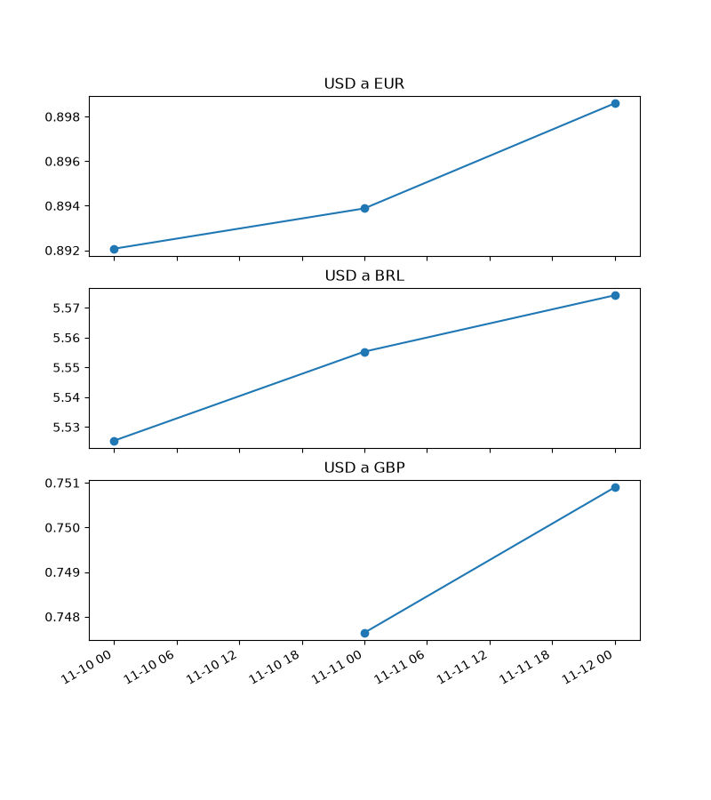

# Tipo de cambio diario

Script en Python que consulta cada día las tasas del dólar (USD) frente al euro (EUR), el real brasileño (BRL) y la libra esterlina (GBP), las acumula en un CSV y genera un gráfico con un panel por moneda.

Fuente: la API gratuita [Frankfurter](https://frankfurter.dev), que publica tasas de referencia de bancos centrales y otras fuentes oficiales.

Es un proyecto de práctica.

## Qué hace

- Pide a la API las tasas más recientes.
- Las guarda en `tasas.csv` con tres columnas: `fecha`, `moneda` y `valor`. Si ya existe una fila con la misma fecha y moneda, se queda con la más nueva, así que correrlo dos veces el mismo día no duplica filas.
- Ordena el CSV por fecha y moneda.
- Genera `grafico_tasas.png`, con un panel por moneda.
- Anota cada corrida en `bitacora.txt`: una línea con la hora y `OK` o `ERROR` con el motivo.

Los archivos se crean siempre junto al script, sin importar desde qué carpeta se ejecute.

## Ejemplo

Primeras filas de `tasas.csv`:

```
fecha,moneda,valor
2026-11-10,BRL,5.5254
2026-11-10,EUR,0.89207
2026-11-11,BRL,5.5553
2026-11-11,EUR,0.89383
2026-11-11,GBP,0.74757
```

Gráfico generado:



## Cómo usarlo

Requisitos: Python (probado con 3.12) y las bibliotecas `requests`, `pandas` y `matplotlib`:

```
pip install requests pandas matplotlib
```

Ejecutar:

```
python Proyecto02.py
```

Para cambiar las monedas, edita `quotes` en `parametros` y la lista `monedas` del script.

## Cómo programarlo en Windows

Con el Programador de tareas, "Crear tarea básica", una vez al día:

- **Programa o script:** la ruta completa del `python.exe` que tiene las bibliotecas instaladas.
- **Agregar argumentos:** la ruta completa de `Proyecto02.py`, entre comillas si tiene espacios.
- **Iniciar en:** la carpeta del script, sin comillas.

Conviene activar en las propiedades de la tarea la opción de ejecutarla lo antes posible si se omitió un inicio programado, y exigir una conexión de red.

## Limitaciones

- Son tasas de referencia de bancos centrales y fuentes oficiales. No son el dólar paralelo ni el precio de una casa de cambio.
- La API devuelve una fila por cada día del calendario, también en fines de semana, y la tasa de un mismo día puede cambiar entre corridas. El script guarda la última.
- La tarea programada necesita la computadora encendida y con internet. Si algo falla, la bitácora lo registra y el CSV no cambia.

## Archivos

- `Proyecto02.py`: el script diario.
- `ejemplo_grafico.png`: gráfico generado por el script, usado en este README.
- `.gitignore`: deja fuera los archivos locales, como los que el script crea en cada corrida.

## Tecnologías

Python, requests, pandas y matplotlib.
